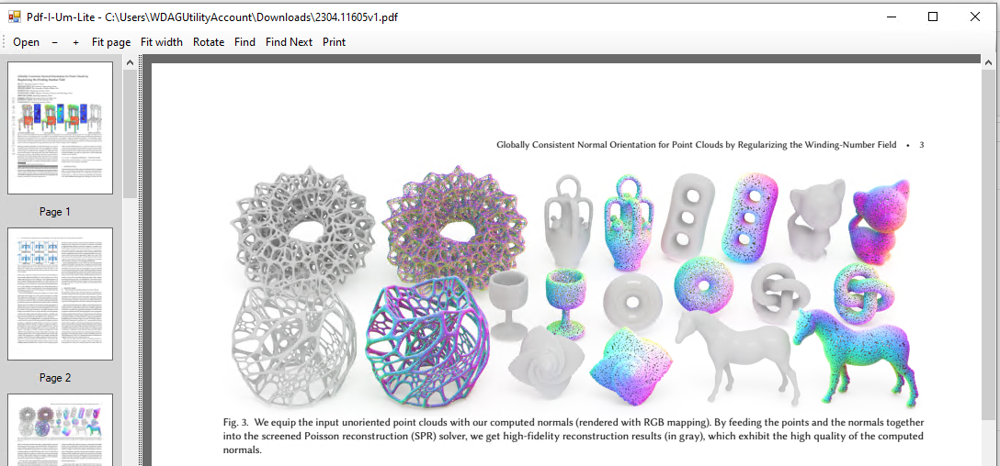

# PDF-I-Um Viewer

A lightweight, self-building PDF viewer for Windows.  
Simply download the CMD and run. No binary installer. No tabs. No fuss.  

PDF-I-Um is a compact Windows PDF viewer built in native Windows C# using lightest PDFium.dll for native rendering (for the hard work).

Designed to run even on older Windows systems as well as modern Windows, thus including Windows 7 32-bit.  

Attribution: PDFium 158.0.8125 – Benoît Blanchon NuGet distribution (Apache-2.0 package licence).  

## Getting started
Download just the cmd file or clone this repository as a zip file and run:

PDF-I-Um.cmd

The CMD file downloads the required PDFium runtime if necessary and compiles the application locally using the installed .NET Framework C# compiler.

No precompiled executable or NuGet installation is required.

# Opening documents
Double-click the application, use Open, or simply drag a PDF onto its window.

You can also launch it with a filename:

PDF-I-Um.exe "My Document.pdf"

Dropping another PDF onto the existing window replaces the current document. No tabs, no multiple-document clutter.

# Compatibility
Windows 7 SP1 (32-bit or x64)  
Windows 10  
Windows 11  
Requires the out of box already installed by Windows 4.NET Framework compiler and the appropriate PDFium x86 runtime which you can update as required..  

# Technical notes
C# / Windows Forms  Proof of concept simply add icons and any functions you need or change the dll for newer/different abilities.  
PDFium native rendering engine, viewer code is compiled locally with Microsoft's inbuilt C# compiler  
Target architecture: x86  (AND thus x64 too)  
PDFium runtime PDFium 158.0.8125, distributed by Benoît Blanchon via NuGet (bblanchon.PDFium.Win32).  
Package licence: Apache License 2.0.  
**Copyright and third-party notices remain with their respective owners.**  

## PDF-I-Um — just open a PDF.  
